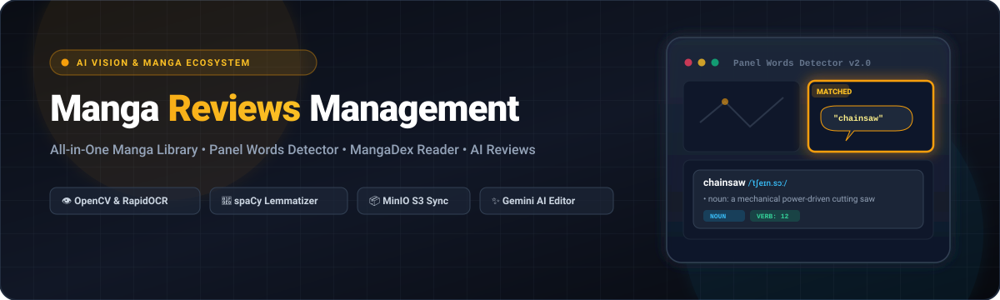
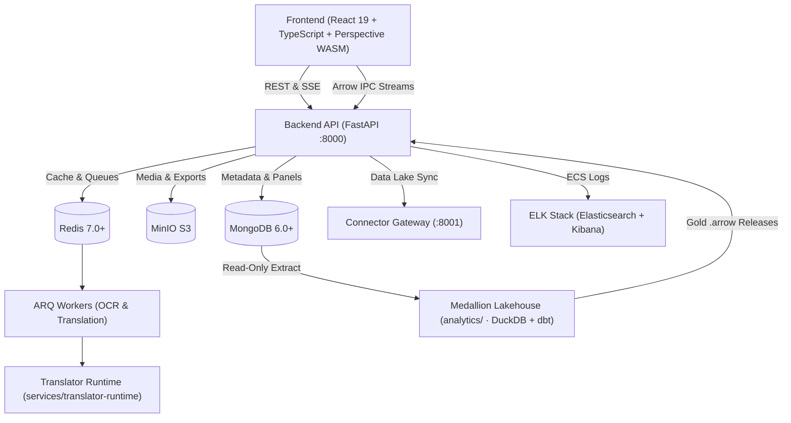

# Manga Reviews Management & AI Vision Lexis System

<p align="center">
  
</p>

<p align="center">
  <strong>A self-hosted Manga Library, Multi-Source Reader, Interactive Review Studio, Vision Dialogue Search, and Medallion OLAP Analytics Platform.</strong>
</p>

<p align="center">
  
  
  
  
  
  
  
  
  
  
  
</p>

> 🤖 **AI Coding Assistant & Contributor Quick Links**:
> - **Orientation & Stack Truth**: [`docs/ai-context.md`](docs/ai-context.md)
> - **Architecture & Sequence Flows**: [`docs/architecture.md`](docs/architecture.md)
> - **Task-to-Files Locator**: [`docs/code-map.md`](docs/code-map.md)
> - **Local Setup & Testing**: [`docs/development.md`](docs/development.md)
> - **Agent Coding Guidelines**: [`AGENTS.md`](AGENTS.md)
> - **Security Policy**: [`SECURITY.md`](SECURITY.md)
> - **Changelog & Version History**: [`docs/CHANGELOG.md`](docs/CHANGELOG.md)

---

## 🌟 Overview

**Manga Reviews Management** is a self-hosted manga platform combining **local S3 storage (MinIO)**, **multi-source chapter ingestion** (MangaDex, MangaFire, Comix), a **progressive reader**, a **rich review editor**, **Computer Vision dialogue indexing**, a **Data Lake Pool + Connector API**, and an offline **Medallion DuckDB/dbt/Arrow OLAP workbench**.

---

## ✨ Key Features

### 1. 🌐 Manga AI Translation Studio & In-Reader Translation

**Current status:** the UI and protocol harness exist; real inference is not integrated.
New translation jobs return a clear 503 and synthetic outputs cannot be published.
See the [operational runbook](docs/translation/operational-runbook.md) for readiness requirements.

- **Reader Split-View Comparison**: Compare original manga artwork and AI-translated pages using an interactive split comparison slider (`clip-path`) or toggle mode.
- **Dedicated Translation Studio (`/translation`)**: 7-tab console for chapter job orchestration, typography diagnostics, synthetic mock workspace, and live storage audit.
- **Isolated Subprocess Runtime Envelope**: `services/translator-runtime` provides a tested protocol harness with explicit synthetic mode. Integrating and validating real OCR, translation and inpainting remains outstanding.
- **Pure-Canvas Re-rendering (Zero LLM Tokens)**: Pillow-based canvas renderer enables instant font, alignment, and translation text tweaks without paying extra LLM token costs.
- **Typography Workspace**: Font upload and rendering controls are present; reliable glyph coverage and overflow validation remain under development.
- **Sequential ZIP Chapter Export**: Export translated chapters with zero-padded filenames and structured `manifest.json`.

### 2. 🔍 Panel Words Detector (Manga Lexis & Vision V3)
- **Segmentation & OCR**: OpenCV contours, RapidOCR (`PP-OCRv4`), and `MangaOCRService` cleanup extract dialogue across complex bubbles.
- **NLP Lemmatization**: `spaCy` (`en_core_web_sm`) and `wordninja` normalize comic lettering for library-wide word/lemma search.
- **In-RAM Panel Streaming & Dictionary**: Dynamic JPEG panel cropping from MinIO bytes with interactive word popover and jump-to-reader shortcuts.

### 3. 📖 Immersive Reader (`/manga/:id/read/:chapterId`) & Export
- **Progressive Streaming**: Long Strip, Single Page, Double Page (LTR/RTL), smooth zoom (`30%–300%`), keyboard navigation, and preload queue.
- **Storage & Multi-Format Export**: Export chapters to PDF, CBZ, ZIP, or folder with SSE progress; lossless MinIO `.mgtile` optimization tools.

### 4. 📊 Analytics Hub & Medallion OLAP Lab (`/analytics`)
- **Classic BI & AI Export (5 Tabs)**: Redis-cached MongoDB `$facet` aggregations (`Thư viện`, `Reviews`, `Tác giả`, `Tags`) and structured AI review corpus export.
- **Medallion OLAP Tab (`/analytics?tab=olap-lab`)**: Offline [`analytics/`](analytics/RUNBOOK.md) pipeline (MongoDB read-only -> Bronze Parquet -> DuckDB/dbt 21 Silver & 9 Gold marts -> Apache Arrow IPC) served read-only via `/api/analytics-lab/*` into client-side **Perspective WASM** (raw prose excluded).

### 5. 📥 Multi-Source Ingestion, Data Lake Pool & Connector
- **Multi-Source Downloader**: Unified MangaDex, MangaFire, and Comix chapter plans with logical `chapter_slots` and metadata merge field locks.
- **Data Lake Pool & Connector Gateway**: Curated `manga-reader-package:2.0` packages served via isolated ASGI gateway (`backend/connector_app.py`, port `8001`, HMAC-SHA256 CDC webhooks).

### 6. ✍️ Rich Review Studio, Tierlists & Gemini AI
- **TipTap WYSIWYG Editor**: Slash commands, resizable media, `@manga` mentions, and Gemini Flash review rewriting/ideas assistance.
- **Creator Profiles & Tierlists**: Author/artist detail pages (`/author/:id/:slug`) with drag-and-drop Creator Tier List Maker and snapshots.
- **External Reviews Hub**: Scrape and compare MAL reviews/metadata alongside personal scores.

### 7. ⚡ Caching, Async Workers & ELK Observability
- **Redis & ARQ**: Sub-millisecond caching with MongoDB fallback plus decoupled ARQ workers (`ocr`, `translation`).
- **Audit Logs & ELK**: Redacted ECS NDJSON logs (`logs/manga-*.ndjson`), Elasticsearch search, and embedded Kibana in `/audit-logs` (see [`docs/logging.md`](docs/logging.md)).

---

## 🏗️ Architecture



---

## 🛠️ Technology Stack

| Layer | Technologies |
|---|---|
| **Backend** | Python 3.12 (`uv`), FastAPI, Motor (Async MongoDB), Pydantic v2, Uvicorn |
| **Medallion OLAP** | DuckDB, `dbt-duckdb`, PyArrow IPC, Parquet, Perspective WASM (`@perspective-dev/*`) |
| **Vision, NLP & AI** | OpenCV, RapidOCR (`PP-OCRv4`), spaCy, Wordninja, MangaOCR, Gemini API |
| **Translation Plane** | Isolated Subprocess Runner (`services/translator-runtime`), Pillow, TTF Validator |
| **Caching & Queues** | Redis Alpine, ARQ (Async Redis Queue workers) |
| **Frontend** | React 19, TypeScript 6, Tailwind CSS v4, shadcn/ui (`radix-nova`), Vite 8, TipTap |
| **Datastores & Logs** | MongoDB 6.0+, MinIO S3 (`manga-library`), Elasticsearch, Kibana, ECS Logging |
| **Testing & QA** | Pytest, Ruff, Biome, `@axe-core/cli`, Playwright |

---

## 🚀 Quick Start Guide

Detailed guide available at [`docs/development.md`](docs/development.md).

### 1. Prerequisites
- [Docker](https://www.docker.com/) & Docker Compose
- [Node.js](https://nodejs.org/) (v20 or newer) & [pnpm](https://pnpm.io/) (v10 or newer)
- [Python](https://www.python.org/) (v3.12 or newer) & [`uv`](https://docs.astral.sh/uv/)
- [MongoDB](https://www.mongodb.com/) (v6.0 or newer running locally or via dedicated container on port 27017)

---

### 2. Infrastructure Setup (MinIO & Redis)

1. Configure environment variables first:

```bash
cp backend/.env.example backend/.env
```

2. Start MinIO and Redis containers using Docker Compose:

```bash
docker compose --env-file backend/.env -f backend/docker-compose.yml up -d minio redis
```

- **MinIO S3 API**: `http://localhost:9000`
- **MinIO Web Console**: `http://localhost:9001` (Credentials: configured in `backend/.env`)
- **Redis**: `localhost:6379`
- *Note*: Ensure MongoDB is running on `localhost:27017`.

---

### 3. Backend Setup

1. Sync dependencies with `uv`:

```bash
uv sync --project backend
```

2. Initialize database indexes and seed tags:

```bash
uv run --project backend python setup_env.py
uv run --project backend python seed_mangadex_tags.py
```

4. Start FastAPI server:

```bash
uv run --project backend uvicorn backend.main:app --reload --host 127.0.0.1 --port 8000
```
Swagger UI will be at `http://localhost:8000/docs`.

5. *(Optional)* Start ARQ background workers in separate terminals:

```bash
# Vision OCR Worker (Panel segmentation and NLP lexis extraction)
uv run --project backend arq backend.tasks.worker.WorkerSettings

# Translation Worker (Manga AI chapter translation pipeline)
uv run --project backend arq backend.tasks.translation_worker.WorkerSettings
```

---

### 4. Frontend & Medallion Analytics Setup

1. Install & start Vite dev server (`http://localhost:5173`):

```bash
pnpm --dir frontend install
pnpm --dir frontend dev
```

2. *(Optional)* Build offline DuckDB/dbt/Arrow marts for the **Medallion OLAP Lab** tab (`/analytics?tab=olap-lab`, see [`analytics/RUNBOOK.md`](analytics/RUNBOOK.md)):

```bash
uv run --project analytics python -m analytics.scripts.run_pipeline --allow-existing-uri
```

---

### 5. Bypass ISP Blocking (Windows)

If MangaDex is blocked by your ISP:
- **Start**: `npm run dpi:start` or run `tools/goodbyedpi/start-dpi.cmd` (Admin).
- **Check**: `npm run dpi:status`
- **Stop**: `npm run dpi:stop` or `tools/goodbyedpi/stop-dpi.cmd`.

