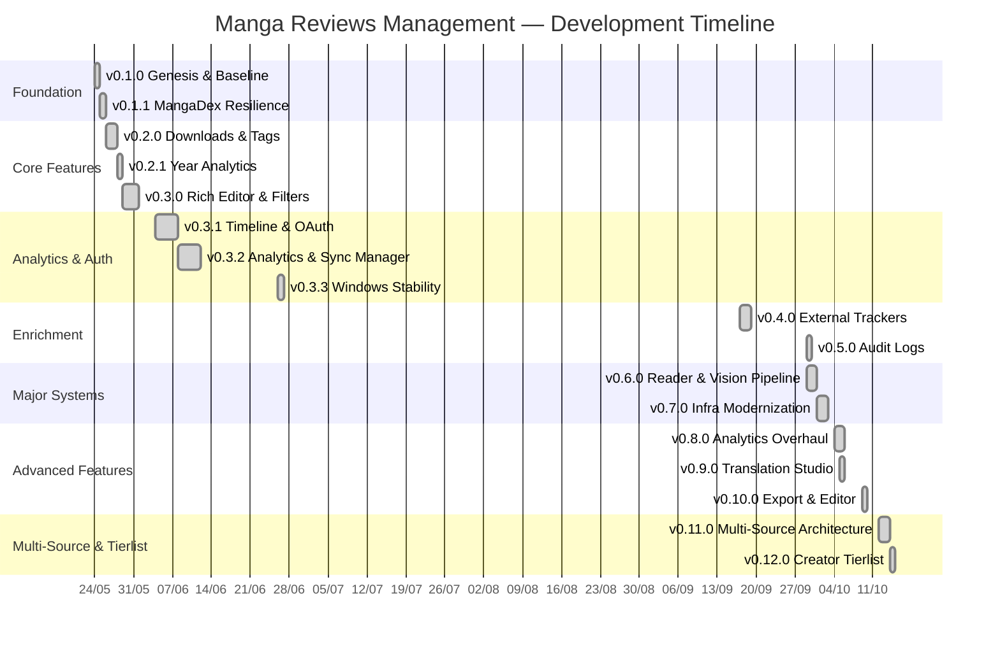

# 📜 Changelog — Manga Reviews Management & AI Vision Lexis System

> **Phiên bản tài liệu**: 1.0.0  
> **Cập nhật lần cuối**: 14/10/2026  
> **Tổng số commit**: 179 (single contributor: **Huy1411**)  
> **Giai đoạn**: 24/05/2026 → 14/10/2026 (~5 tháng phát triển liên tục)  
> **Nhánh chính**: `main` (trước đó: `master`)

---

## Quy ước (Conventions)

| Ký hiệu | Loại thay đổi (Change Type) |
|---|---|
| 🚀 Release | Đóng gói milestone, tái cấu trúc hệ thống lớn |
| 🆕 Added | Tính năng mới hoàn toàn |
| 🔧 Changed | Cải tiến, tái cấu trúc, hoặc nâng cấp tính năng có sẵn |
| 🐛 Fixed | Sửa lỗi |
| 🎨 Style | Thay đổi giao diện, CSS, typography |
| ⚡ Perf | Tối ưu hiệu suất |
| 📝 Docs | Cập nhật tài liệu |
| 🏗️ Infra | Hạ tầng, CI/CD, tooling, DevOps |
| ⚠️ Breaking | Thay đổi phá vỡ tương thích ngược |

---

## Bảng tổng hợp Changelog (Change Log Summary Table)

| Phiên bản (Version) | Ngày cập nhật | Hạng mục / Tính năng | Loại thay đổi | Mô tả chi tiết công việc | Người thực hiện | Trạng thái |
| **v0.13.0** | 18/10/2026 | ELK Observability Stack & Structured Logging | 🆕 Added | Kiến trúc ELK Stack hoàn chỉnh: ecs-logging, structured logging với dynamic secret redaction & request tracing (`X-Trace-Id`), Elasticsearch sync worker, 3-tab Observability Center trên `/audit-logs` với Native ECS Log Viewer và Kibana Embed. | Huy1411 | ✅ Đã hoàn thành |
| **v0.13.0** | 18/10/2026 | Real MangaTranslator Engine Integration | 🚀 Release | Tích hợp engine MangaTranslator thực tế trên GPU GTX 1660 Ti (CUDA), YOLOv8 speech bubble detector, Gemini 2.5 Flash Lite dialogue translator, isolated Python runtime runner, và dynamic hardware/engine readiness probing. | Huy1411 | ✅ Đã hoàn thành |
| **v0.13.0** | 18/10/2026 | Manga Reader Performance & Progressive Streaming | ⚡ Perf | Non-blocking progressive image streaming (trang tải xong hiển thị tức thì, ưu tiên tuyệt đối cho `?page=x`), hàng đợi nạp trước thông minh (`useMangaPreloadQueue`), Skeleton shimmer giữ chỗ theo đúng tỷ lệ gốc (`aspectRatio: width / height`). | Huy1411 | ✅ Đã hoàn thành |
| **v0.13.0** | 18/10/2026 | Reader Boundary Navigation & Panel Detector Modal | 🐛 Fixed | Điều hướng cross-chapter liền mạch: lùi chapter chuyển về trang cuối cùng (`?page=last`), chạm giới hạn 2 đầu tự động thoát về Manga Details. Kết nối và hiển thị `PanelDetailModal` khi click nút "Chi tiết" trong Panel Words Detector. | Huy1411 | ✅ Đã hoàn thành |
| **v0.12.0** | 14/10/2026 | Creator Tier List Maker | 🆕 Added | Thiết kế models, database indexes, migration cho Creator Tierlists. Implement `TierlistService` + REST router endpoints (CRUD, reorder, snapshot, restore) kèm unit tests. Xây dựng frontend components (`TierlistMaker`, `TierRow`, `TierPoolArea`, `TierlistFeedbackModal`), tích hợp tab Creator Tierlist vào `AuthorDetailPage`, resizable 2-column split layout, custom feedback modals thay thế native alert/confirm. | Huy1411 | ✅ Đã hoàn thành |
| **v0.12.0** | 14/10/2026 | Typography & Font Rendering | 🎨 Style | Tối ưu hiển thị font tiếng Việt với Be Vietnam Pro và Inter, cải thiện Vietnamese diacritics rendering trên toàn hệ thống. | Huy1411 | ✅ Đã hoàn thành |
| **v0.11.0** | 12–13/10/2026 | Multi-Source Ingestion Architecture (PR00–PR08) | 🚀 Release | Kiến trúc multi-source hoàn chỉnh qua 9 PR tuần tự: ADR & MangaFire live spike → contracts & registry → identity schema & migration → media staging & download plan → lifecycle epoch fencing & slot reconciliation → MangaFire provider adapter & download pipeline → metadata enrichment & merge preview & field locks → slot-based reader navigation & ReleaseSwitcher → acceptance matrix verification & documentation sync. | Huy1411 | ✅ Đã hoàn thành |
| **v0.11.0** | 13/10/2026 | Storage & Downloader UX | 🔧 Changed | Khôi phục rich MangaDex downloader UX, 3-column chapter card grid, spacious multi-source dialog layout. Sửa 409 Conflict bằng source linkage & auto_link trong download plans. Thêm deselect-all chapters action, detailed URL resolution progress pipeline. | Huy1411 | ✅ Đã hoàn thành |
| **v0.11.0** | 13/10/2026 | Chapter Storage Manager | 🆕 Added | Chapter metadata editing inline, live progress bars, scalable language filter, và UI overhaul toàn diện cho Storage Manager. | Huy1411 | ✅ Đã hoàn thành |
| **v0.11.0** | 13/10/2026 | CI/CD Fixes | 🐛 Fixed | Unit tests cho multisource download plan trở nên hermetic, mock MinIO staging để test không phụ thuộc hạ tầng. | Huy1411 | ✅ Đã hoàn thành |
| **v0.10.0** | 09/10/2026 | Multi-Format Chapter Export | 🆕 Added | Xuất chapter đã tải thành PDF, ZIP, CBZ hoặc thư mục ảnh. Real-time SSE progress bar, tích hợp mở thư mục trực tiếp trong Windows Explorer. | Huy1411 | ✅ Đã hoàn thành |
| **v0.10.0** | 09/10/2026 | Review Editor Enhancements | 🔧 Changed | Thêm nút & shortcut Clear Formatting (`Ctrl+\`), sticky word count dock không chồng lấp, sửa layout header bị co, thêm bullet clearing, khôi phục smooth width preset animation trên review canvas. | Huy1411 | ✅ Đã hoàn thành |
| **v0.9.0** | 05/10/2026 | Translation Studio & Reader Translation | 🆕 Added | Tích hợp Manga Reader Translation Studio: isolated runtime envelope, reader split-view comparison (clip-path slider), dedicated studio workspace (`/translation`) với 7-tab console, pure-canvas Pillow re-rendering (Zero LLM), legacy fonts scan, profile typesetting font selector. ErrorBoundary cho crash safety. | Huy1411 | ✅ Đã hoàn thành |
| **v0.9.0** | 05/10/2026 | Translation Pipeline Fixes | 🐛 Fixed | Persist `page_uid` trong `chapter_service`, backfill pages, `page_number` fallback trong `job_service`. In-process execution fallback, update parent job state, sửa MinIO client initialization. Resolve static import error cho `probe_compatibility` via service delegation. | Huy1411 | ✅ Đã hoàn thành |
| **v0.8.0** | 04–05/10/2026 | Analytics Overhaul & KPI Deck | 🆕 Added | Tái cấu trúc Analytics tabs, thêm Reviews Management tab, AI corpus export. Storytelling KPI deck, multi-view read status card. Sửa focus outline, clipping trong rating tiers và bar distribution. Mở rộng page containers full width toàn bộ main tabs. | Huy1411 | ✅ Đã hoàn thành |
| **v0.8.0** | 04/10/2026 | CI/CD Pipeline Hardening | 🐛 Fixed | Chỉ định pnpm version, thêm Redis service container cho backend tests. Thêm `@tiptap/core` vào dependencies cho strict pnpm resolution. | Huy1411 | ✅ Đã hoàn thành |
| **v0.7.0** | 01–02/10/2026 | AI Tooling & Developer Experience | 🏗️ Infra | Cấu hình CodeGraph MCP knowledge graph, agent governance rules. Tích hợp ast-grep, repomix, ruff, biome tooling ecosystem. Migrate frontend từ npm → pnpm, backend từ pip → uv. Thiết lập autonomous agent skills system (TDD, Architecture Guard, DB Migration Safety, UI/UX Design, CI/CD Guardian). | Huy1411 | ✅ Đã hoàn thành |
| **v0.7.0** | 02/10/2026 | Redis Caching & ARQ Workers | 🆕 Added | Tích hợp Redis caching layer (`manga:detail`, `reviews:manga`) với auto-fallback khi Redis offline. ARQ async worker cho OCR tasks (`process_manga_panel_ocr`). Docker Compose cho Redis Alpine. | Huy1411 | ✅ Đã hoàn thành |
| **v0.7.0** | 02/10/2026 | shadcn/ui Design System | 🚀 Release | Khởi tạo shadcn/ui design system (`radix-nova`), visual test runner, UI/UX skill governance. Thay thế ad-hoc styling bằng semantic Tailwind tokens (`bg-background`, `text-foreground`, `brand-orange`, `brand-coral`). | Huy1411 | ✅ Đã hoàn thành |
| **v0.7.0** | 02/10/2026 | Vision Pipeline V3 | 🆕 Added | Kiến trúc Vision Pipeline V3: evaluation metrics, regression suite, panel detail inspector modal, technical AI report generator. Embed raw original page images trước extracted panels trong audit reports. | Huy1411 | ✅ Đã hoàn thành |
| **v0.7.0** | 02/10/2026 | CI/CD Pipeline | 🏗️ Infra | Implement GitHub Actions CI/CD pipeline với aggregate `ci-gate`. CI Guardian skill. Gitleaks CLI với allowlist. Playwright visual testing. Automated CodeGraph memory sync qua post-commit hook. | Huy1411 | ✅ Đã hoàn thành |
| **v0.7.0** | 02/10/2026 | Documentation & AI Readiness | 📝 Docs | Triển khai remote AI context architecture (`docs/ai-context.md`, `docs/architecture.md`, `docs/code-map.md`), Mermaid diagrams (ERD, sequence diagrams), anti-drift tooling (`check_docs.py`, `generate_api_routes.py --check`). | Huy1411 | ✅ Đã hoàn thành |
| **v0.7.0** | 01/10/2026 | OCR Pipeline Enhancements | 🔧 Changed | Nâng cấp manga panel words detector: bilingual support (EN/JP), bubble extraction mode. System-wide panel scanner, enhanced concurrency. MangaOCRService post-processing. Sửa spacy wheel timeout, implement scan cancel mechanism. | Huy1411 | ✅ Đã hoàn thành |
| **v0.6.0** | 29–30/09/2026 | Manga Reader & Chapter Storage | 🆕 Added | Backend: chapter storage models, service, folder importer, reader APIs, downloader integration. Frontend: MangaReader (Webtoon/Single/Double page modes), ChapterStorageManager với Drive-like explorer. Revamp tabs layout, dedicated reader page, multi-group translation merge. | Huy1411 | ✅ Đã hoàn thành |
| **v0.6.0** | 30/09/2026 | Vision & Dialogue Pipeline | 🆕 Added | Implement AI vision & dialogue extraction pipeline: RapidOCR (PP-OCRv4), spaCy NLP lemmatization, cascading constraints. Panel & Dialogue Lexis tab, visual search, interactive dictionary popover, golden focus frame. Library-wide Panel Words Detector sidebar tab với global search. | Huy1411 | ✅ Đã hoàn thành |
| **v0.6.0** | 30/09/2026 | Download & Storage Optimization | ⚡ Perf | Tối ưu batch downloads, ngăn backend freeze. Multi-language download filtering, manga reader language sequencing. Advanced chapter pagination (custom page sizes, smart navigation, quick jumper). Preserve MangaDex volume và rich metadata. | Huy1411 | ✅ Đã hoàn thành |
| **v0.6.0** | 30/09/2026 | Real-time Progress Dashboard | 🆕 Added | Comprehensive real-time progress dashboard cho folder import, storage, và feed operations. SSE stream tracking. | Huy1411 | ✅ Đã hoàn thành |
| **v0.6.0** | 30/09/2026 | Reader UX Fixes | 🐛 Fixed | Sửa reader overlap, double page mode, zoom controls, chapter image preview lightbox, checkbox fix, volume grouping, batch deselect. Stabilize panel search, API media URLs, mobile navigation. | Huy1411 | ✅ Đã hoàn thành |
| **v0.6.0** | 30/09/2026 | GitHub Preparation | 📝 Docs | Chuẩn bị project cho GitHub: comprehensive README, `.env.example`, clean `.gitignore`, responsive SVG banner. | Huy1411 | ✅ Đã hoàn thành |
| **v0.5.0** | 29/09/2026 | Audit Logs & Data Protection | 🆕 Added | Centralized audit log service, dedicated audit explorer UI, manual manga filter API. Prevent duplicate review creation, protect library manga data. | Huy1411 | ✅ Đã hoàn thành |
| **v0.5.0** | 29/09/2026 | Metadata & Localization | 🔧 Changed | Russian language support, redesign Edit Metadata modal với auto-resizing synopsis. Preserve `cover_url` khi update metadata không thay đổi. | Huy1411 | ✅ Đã hoàn thành |
| **v0.4.0** | 17–18/09/2026 | External Tracker Integration | 🆕 Added | Tích hợp metadata từ AniList và MyAnimeList (external tracker enrichment). Sửa type mapping trong SyncManagerPage. | Huy1411 | ✅ Đã hoàn thành |
| **v0.3.3** | 26/06/2026 | Stability & Windows Fixes | 🐛 Fixed | Sửa creator filtering, cover image recovery, Windows file path download errors. Giải quyết các vấn đề tương thích trên môi trường Windows. | Huy1411 | ✅ Đã hoàn thành |
| **v0.3.2** | 09–11/06/2026 | Advanced Analytics & Visualizations | 🆕 Added | Tag distributions & rating score visualizations. Enhanced tooltips contrast, rankings indices, percentages. Rank badges & pool percentage cho Score Averages và Creator Distributions. Timestamp sorting, real-time import progress stream UI, refined creator biography layout. | Huy1411 | ✅ Đã hoàn thành |
| **v0.3.2** | 08/06/2026 | Sync Manager Dashboard | 🆕 Added | Sync manager dashboard, active background abort controls, cover gallery sync, recommendations contrast/filter fixes, auto-sync on import. | Huy1411 | ✅ Đã hoàn thành |
| **v0.3.2** | 09/06/2026 | Manual Manga & Tags | 🔧 Changed | Nâng cấp form thêm manga thủ công: original language, demographic, content rating, volumes, chapters. Resolve duplicate Romance tags, tag counts via aggregation, tag statistics UI. | Huy1411 | ✅ Đã hoàn thành |
| **v0.3.1** | 04–07/06/2026 | Timeline & Authentication | 🆕 Added | Completed manga completion timeline chart, date range filters, timeline range controls, data grouping, date picker validation. OAuth2 fallback cho MangaDex API. `mangadex_access.txt` fallback configuration. | Huy1411 | ✅ Đã hoàn thành |
| **v0.3.1** | 08/06/2026 | Backend Security | 🐛 Fixed | Escape regex metacharacters trong search queries và creator name lookup để ngăn ReDoS injection. | Huy1411 | ✅ Đã hoàn thành |
| **v0.3.0** | 29–31/05/2026 | Rich Review Editor (TipTap) | 🆕 Added | Enhance review editor: resizable images, tables, YouTube embed, video/audio uploads, file attachments. Sticky action bar, dynamic formatting toolbar stacking. Image cropping, table bubble menu, BubbleMenu integration. | Huy1411 | ✅ Đã hoàn thành |
| **v0.3.0** | 29/05/2026 | Metadata CRUD | 🔧 Changed | Mở rộng manga metadata CRUD, sửa review images MinIO bucket policy. | Huy1411 | ✅ Đã hoàn thành |
| **v0.3.0** | 30–31/05/2026 | Library Filtering & Navigation | 🔧 Changed | Multi-selection read status filters (includes/excludes). Percentage labels trên pie charts. Fix grid/card view click navigation. MangaListPage navigation sync filter state to URL. | Huy1411 | ✅ Đã hoàn thành |
| **v0.3.0** | 31/05/2026 | Livestream Mode | 🆕 Added | Hide rating option trong livestream settings, blur scores trong frontend views. | Huy1411 | ✅ Đã hoàn thành |
| **v0.2.1** | 28/05/2026 | Publication Year Analytics | 🆕 Added | Publication year distribution chart, multi translation groups download support. Template quick-fill cho year epoch custom ranges. Read status breakdown mode, zoom in/out controls trên chart. | Huy1411 | ✅ Đã hoàn thành |
| **v0.2.0** | 27/05/2026 | Download Manager Robustness | 🔧 Changed | Task recovery, skip-completed optimization, manual resume, idle polling optimization. Real-time progress updates và progress bar UI cho duplicate image scanning. | Huy1411 | ✅ Đã hoàn thành |
| **v0.2.0** | 26/05/2026 | Livestream Mode & Interactive Detail | 🆕 Added | Implement Livestream Mode (Cover Blur) settings & rendering, interactive status/rating selects trên detail page. | Huy1411 | ✅ Đã hoàn thành |
| **v0.2.0** | 26/05/2026 | Tags & Import System | 🔧 Changed | GroupedTagSelector with search filter, CreatorLiveSearchInput suggestions cho add manga manually/import. Alt titles CRUD UI, merge alt titles during MangaDex sync. Content Rating Distribution pie chart thay thế Language Origin chart. | Huy1411 | ✅ Đã hoàn thành |
| **v0.2.0** | 26/05/2026 | Downloads Tracking UI | 🆕 Added | Global background download tracking UI, persistent widget, dedicated Downloads Manager page. Path verification button, backend validation route. | Huy1411 | ✅ Đã hoàn thành |
| **v0.1.1** | 25/05/2026 | MangaDex Anti-Block & Networking | 🔧 Changed | User-Agent rotation, proxy support, sync Playwright fallback cho MangaDex. Ngrok tunneling support (allow all hosts, API proxying). Bypass hotlinking checks bằng no-referrer policies trên MangaDex covers. | Huy1411 | ✅ Đã hoàn thành |
| **v0.1.1** | 25/05/2026 | Markdown & Styling | 🆕 Added | Markdown table parsing support cho manga description. Điều chỉnh table header/cells text colors cho optimal contrast. | Huy1411 | ✅ Đã hoàn thành |
| **v0.1.0** | 24/05/2026 | Initial Baseline | 🚀 Release | Khởi tạo project: FastAPI backend + React frontend SPA. Core library management (MangaDex sync, manga CRUD), download system (configurable base path, folder sanitization, title quick-append, feasibility check, download path database sync). Customizable page size selector, sticky toolbar. | Huy1411 | ✅ Đã hoàn thành |
| **v0.1.0** | 24/05/2026 | Image Tools | 🆕 Added | Duplicate scanner & format converter tools với multi-threading backend service. Full-screen zoomable lightbox, group-level Clean Mode selection, group-level Delete Selected. | Huy1411 | ✅ Đã hoàn thành |

---

## Chi tiết từng phiên bản (Detailed Version History)

### v0.13.0 — Observability Stack, Real MangaTranslator, & Reader Performance *(18/10/2026)*

**Tổng quan**: Nâng cấp toàn diện hạ tầng quan sát hệ thống (ELK Stack & ECS logging), tích hợp engine dịch thuật MangaTranslator thực tế (CUDA GPU + Gemini Pro fallback), tối ưu hóa triệt để tốc độ nạp trang truyện (progressive non-blocking streaming & smart preloader queue), sửa lỗi điều hướng ranh giới chapter liền mạch và kết nối modal chi tiết từ vựng/panel.

| Thay đổi | Chi tiết |
|---|---|
| 🆕 ELK Observability Stack | Elasticsearch & Kibana Docker Compose, ecs-logging JSON formatter, dynamic query API, sanitization & secret redaction |
| 🆕 Observability Center UI | 3-tab console tại `/audit-logs` với Native ECS Log Viewer, LogQL search, log detail modal, và Kibana Embed tab |
| 🚀 Real MangaTranslator Engine | Kết nối isolated runner với CUDA GTX 1660 Ti, YOLOv8 speech bubble detector, Gemini 2.5 Flash Lite translation, hardware & engine readiness probe |
| ⚡ Reader Progressive Streaming | Tải và hiển thị độc lập từng trang truyện, ưu tiên độ trễ thấp nhất cho `?page=x` (`fetchPriority="high"`, `loading="eager"`), Skeleton shimmer chuẩn tỷ lệ gốc (`aspectRatio`) |
| ⚡ Smart Image Preloader Queue | Hook `useMangaPreloadQueue` tự động nạp trước các trang kế tiếp vào Browser Cache ngầm với concurrency control |
| 🐛 Seamless Boundary Navigation | Lùi chapter nhảy về trang cuối cùng (`?page=last`), chạm giới hạn 2 đầu tự động thoát về Manga Details, đồng bộ URL `?page` mượt mà |
| 🐛 Panel Detail Modal Integration | Kết nối `PanelDetailModal` vào `PanelWordsDetectorPage` khi bấm nút "Chi tiết" |

---

### v0.12.0 — Creator Tier List Maker & Typography *(14/10/2026)*

**Tổng quan**: Hệ thống Creator Tier List cho phép xếp hạng tác giả/họa sĩ manga theo các tier tùy chỉnh, tích hợp trực tiếp vào trang chi tiết Author. Kèm theo nâng cấp typography hệ thống.

**Commits tiêu biểu**: `a8219a7`, `b30ad3e`, `9e7ad8b`, `9b32994`, `5843e91`, `3333baf`, `b7e44c5`

| Thay đổi | Chi tiết |
|---|---|
| 🆕 Tierlist Models & Migration | Định nghĩa Pydantic models, database indexes trong `backend/database/indexes.py`, migration script |
| 🆕 TierlistService & REST API | CRUD endpoints, reorder tiers, snapshot/restore, unit tests với pytest |
| 🆕 Frontend Tierlist Components | `TierlistMaker`, `TierRow`, `TierPoolArea`, `TierlistFeedbackModal` |
| 🔧 Resizable 2-Column Layout | Split layout với drag handle, giải quyết popover clipping |
| 🔧 Custom Feedback Modals | Thay thế native `alert()` và `confirm()` bằng dialog components shadcn |
| 🎨 Vietnamese Font Optimization | Be Vietnam Pro + Inter font stack, cải thiện Vietnamese diacritics |

---

### v0.11.0 — Multi-Source Ingestion & Chapter Slot Architecture *(12–13/10/2026)*

**Tổng quan**: Kiến trúc multi-source hoàn chỉnh cho phép download và đọc manga từ nhiều nguồn (MangaDex, MangaFire) với source-scoped identity, logical slot coverage, safe metadata merging và user field locks. Triển khai qua 9 Pull Request tuần tự (PR00–PR08).

**Commits tiêu biểu**: `ac65c84`, `c95cc02`..`11854cd`, `5ac9bee`..`e547ad4`, `6925f89`

| PR | Thay đổi | Chi tiết |
|---|---|---|
| PR00 | 🆕 Baseline & Spike | Verification infrastructure, MangaFire live spike, ADR documentation, multi-source fixtures |
| PR01 | 🆕 Contracts & Registry | Provider contracts (`SourceProvider`), URL normalization, MangaDex adapter conversion |
| PR02 | 🆕 Identity & Schema | Source-scoped chapter identity, MongoDB schema migration, logical slot coverage |
| PR03 | 🆕 Media Staging | MinIO staging, download plan service, CAS recovery mechanism |
| PR04 | 🆕 Lifecycle Fencing | Epoch fencing, slot reconciliation, translation source integrity guards |
| PR05 | 🆕 MangaFire Provider | MangaFire adapter, download pipeline integration, multi-source dialog UI |
| PR06 | 🆕 Metadata Enrichment | Merge preview, field locks, comparison drawer cho metadata conflict resolution |
| PR07 | 🆕 Slot-Based Reader | Reader navigation theo slot, `ReleaseSwitcher`, source badges, storage grouping |
| PR08 | 📝 Acceptance & Docs | Acceptance matrix verification, documentation sync, rollout readiness |
| — | 🔧 Downloader UX | Restore rich MangaDex downloader, 3-column grid, deselect-all, URL resolution progress |
| — | 🐛 CI Fixes | Hermetic unit tests, mock MinIO staging |

---

### v0.10.0 — Chapter Export & Editor Polish *(09/10/2026)*

**Commits tiêu biểu**: `e17c917`, `928b4e4`, `fef7a70`, `c92125e`, `001148a`, `48d3102`

| Thay đổi | Chi tiết |
|---|---|
| 🆕 Multi-Format Export | PDF, ZIP, CBZ, Folder export với real-time SSE progress bar |
| 🆕 Explorer Integration | Mở thư mục output trực tiếp trong Windows Explorer sau khi export |
| 🐛 Export Service Fixes | Sửa chapter ID filtering và dict mapping trong `chapter_export_service` |
| 🔧 Clear Formatting | Nút & shortcut `Ctrl+\`, bullet clearing |
| 🔧 Sticky Word Count | Non-overlapping sticky header counter, xóa duplicate bottom dock |
| 🐛 Canvas Animation | Khôi phục smooth width preset animation trên review canvas |

---

### v0.9.0 — Translation Studio & Isolated Runtime *(05/10/2026)*

**Commits tiêu biểu**: `e346b4c`, `a2c0d1a`, `2f3f3ea`, `205a9e6`, `e67163f`, `badcc5b`

| Thay đổi | Chi tiết |
|---|---|
| 🆕 Translation Studio | Dedicated `/translation` route, 7-tab console, job orchestration |
| 🆕 Reader Split-View | Interactive clip-path slider so sánh original vs translated page |
| 🆕 Isolated Runtime | Subprocess JSONL envelope cho heavy ML dependencies isolation |
| 🆕 Pure-Canvas Rendering | Pillow-based renderer (Zero LLM token cost) cho font/alignment tweaks |
| 🆕 Font Management | Legacy fonts scan, profile typesetting font selector |
| 🐛 Pipeline Stability | Page UID persistence, backfill, MinIO init, ErrorBoundary, static import fixes |

---

### v0.8.0 — Analytics Restructuring & KPI Storytelling *(04–05/10/2026)*

**Commits tiêu biểu**: `d359b6d`, `ea4dd08`, `48afcab`, `3001ec4`, `0fb3896`, `0ee0c4f`

| Thay đổi | Chi tiết |
|---|---|
| 🆕 Reviews Management Tab | Quản lý reviews trực tiếp từ Analytics dashboard |
| 🆕 AI Corpus Export | Xuất corpus cho AI training/analysis |
| 🆕 KPI Storytelling Deck | Visual storytelling cards cho reading statistics |
| 🔧 Multi-View Read Status | Card với nhiều chế độ hiển thị read status |
| 🐛 CI Hardening | pnpm version pinning, Redis service container, @tiptap/core resolution |
| 🎨 Full-Width Layouts | Mở rộng page containers full width toàn bộ main tabs |

---

### v0.7.0 — Infrastructure Modernization & AI Tooling *(01–02/10/2026)*

**Tổng quan**: Milestone quan trọng nhất về hạ tầng — chuyển đổi toàn bộ toolchain, thiết lập AI agent governance, CI/CD, caching layer, và design system.

**Commits tiêu biểu**: `d767cd3`..`969c2c6`

| Thay đổi | Chi tiết |
|---|---|
| 🏗️ CodeGraph MCP | Knowledge graph cho code intelligence, AST-based impact analysis |
| 🏗️ Tooling Ecosystem | ast-grep, repomix, ruff (Python linter/formatter), biome (TS/TSX) |
| ⚠️ npm → pnpm | Frontend package manager migration, lockfile conversion |
| ⚠️ pip → uv | Backend dependency management migration |
| 🏗️ Agent Skills System | TDD workflow, Architecture Guard, DB Migration Safety, UI/UX Design, CI/CD Guardian |
| 🆕 Redis Cache Layer | `manga:detail`, `reviews:manga` với auto-fallback, Docker Compose Redis Alpine |
| 🆕 ARQ Workers | Background OCR queue (`process_manga_panel_ocr`) |
| 🚀 shadcn/ui Design System | Radix Nova theme, semantic Tailwind tokens, visual test runner |
| 🆕 Vision V3 Architecture | Evaluation metrics, regression suite, audit reports với raw page images |
| 🏗️ GitHub Actions CI/CD | Aggregate `ci-gate`, gitleaks, Playwright visual testing |
| 📝 AI Context Architecture | `ai-context.md`, `architecture.md`, `code-map.md`, Mermaid diagrams |
| 🔧 OCR Enhancements | Bilingual EN/JP, bubble extraction, MangaOCRService, scan cancel |

---

### v0.6.0 — Manga Reader, Vision Pipeline & Storage System *(29–30/09/2026)*

**Tổng quan**: Ra mắt các tính năng core: Manga Reader đa chế độ, AI Vision pipeline, Chapter Storage Manager, và chuẩn bị project cho GitHub.

**Commits tiêu biểu**: `006c551`..`83aac13`

| Thay đổi | Chi tiết |
|---|---|
| 🆕 Manga Reader | Webtoon (long strip), Single Page, Double Page (LTR/RTL), 30–300% zoom, keyboard navigation |
| 🆕 Chapter Storage Manager | Drive-like explorer, folder importer, reader APIs, downloader integration |
| 🆕 Vision & Dialogue Pipeline | RapidOCR + spaCy + OpenCV: panel segmentation, OCR, NLP lemmatization |
| 🆕 Panel Words Detector | Library-wide search, interactive dictionary popover, golden focus frame |
| 🆕 Progress Dashboard | Real-time SSE progress cho folder import, storage, feed operations |
| ⚡ Download Optimization | Anti-freeze batch downloads, multi-language filtering, advanced pagination |
| 🐛 Reader UX Fixes | Overlap, zoom, lightbox, checkbox, volume grouping, mobile navigation |
| 📝 GitHub Preparation | README, `.env.example`, `.gitignore`, SVG banner |

---

### v0.5.0 — Audit Logs & Data Integrity *(29/09/2026)*

**Commits tiêu biểu**: `006c551`, `e835a54`, `abff8cf`, `4dbddc7`

| Thay đổi | Chi tiết |
|---|---|
| 🆕 Audit Log Service | Centralized audit logging cho tất cả library operations |
| 🆕 Audit Explorer UI | Dedicated audit explorer page với activity history timeline |
| 🆕 Manual Manga Filter | API lọc manga được thêm thủ công (non-MangaDex) |
| 🐛 Duplicate Prevention | Ngăn tạo review trùng lặp, bảo vệ library manga data |
| 🔧 Russian Language | Thêm hỗ trợ tiếng Nga, redesign Edit Metadata modal |

---

### v0.4.0 — External Tracker Metadata *(17–18/09/2026)*

**Commits tiêu biểu**: `afa01d4`, `88f6e32`, `3048576`, `fd02684`

| Thay đổi | Chi tiết |
|---|---|
| 🆕 AniList Integration | Đồng bộ metadata từ AniList (scores, popularity, genres) |
| 🆕 MyAnimeList Integration | Đồng bộ metadata từ MAL (scores, ranked, members) |
| 🐛 Type Fixes | Sửa stray interface declaration, type mapping cho SyncManagerPage |

---

### v0.3.3 — Windows Stability Patch *(26/06/2026)*

**Commit**: `1761db2`

| Thay đổi | Chi tiết |
|---|---|
| 🐛 Windows Path Fixes | Sửa Windows file path errors trong download process |
| 🐛 Creator Filtering | Sửa lỗi lọc creator trên frontend |
| 🐛 Cover Recovery | Khôi phục cover images bị mất |

---

### v0.3.2 — Advanced Analytics & Sync Manager *(08–11/06/2026)*

**Commits tiêu biểu**: `9a39355`..`3052743`

| Thay đổi | Chi tiết |
|---|---|
| 🆕 Sync Manager Dashboard | Active background abort controls, cover gallery sync, auto-sync on import |
| 🆕 Tag Distributions | Detailed tag distributions, rating score visualizations |
| 🔧 Enhanced Analytics | Rankings indices, percentages, rank badges, pool percentages |
| 🔧 Manual Manga Form | Original language, demographic, content rating, volumes, chapters fields |
| 🆕 Import Progress Stream | Real-time import progress UI, refined creator biography layout |
| 🐛 ReDoS Prevention | Escape regex metacharacters trong search queries |

---

### v0.3.1 — Timeline Analytics & MangaDex Auth *(04–07/06/2026)*

**Commits tiêu biểu**: `2325d7d`..`2577a36`

| Thay đổi | Chi tiết |
|---|---|
| 🆕 Completion Timeline | Manga completion timeline chart với date range filters |
| 🔧 Timeline Controls | Range controls, data grouping, date picker validation |
| 🆕 OAuth2 Fallback | Authenticated OAuth2 fallback cho MangaDex API |
| 🆕 Access Config | `mangadex_access.txt` fallback configuration cho AuthManager |

---

### v0.3.0 — Rich Review Editor & Library Filtering *(29–31/05/2026)*

**Tổng quan**: Nâng cấp lớn cho review editor với TipTap WYSIWYG và cải thiện đáng kể trải nghiệm lọc/tìm kiếm thư viện.

**Commits tiêu biểu**: `c48c37b`..`62e6859`

| Thay đổi | Chi tiết |
|---|---|
| 🆕 TipTap Rich Editor | Resizable images, tables, YouTube embed, video/audio uploads, file attachments |
| 🆕 Image Cropping | In-editor image crop tool |
| 🆕 Table Bubble Menu | Contextual table editing menu |
| 🔧 Sticky Toolbar | Action bar sticky, dynamic formatting toolbar stacking |
| 🔧 Multi-Selection Filters | Read status includes/excludes filtering cho library và analytics |
| 🆕 Pie Chart Labels | Percentage labels với show/hide toggle, CSS opacity optimization |
| 🆕 Livestream Blur | Hide rating option, blur scores trong frontend views |
| 🐛 Editor Stability | 11 bug fixes cho BubbleMenu, image undo, click-to-select, tippyOptions |

---

### v0.2.1 — Publication Year Analytics *(28/05/2026)*

**Commits tiêu biểu**: `3aee75e`..`dd6bb03`

| Thay đổi | Chi tiết |
|---|---|
| 🆕 Year Distribution Chart | Publication year distribution visualization |
| 🆕 Multi-Group Downloads | Hỗ trợ download chapters từ nhiều translation groups |
| 🔧 Template Quick-Fill | Year epoch custom ranges với auto-clamping |
| 🆕 Read Status Breakdown | Read status mode trên publication year chart |
| 🆕 Chart Zoom Controls | Zoom in/out cho publication year distribution |

---

### v0.2.0 — Downloads Manager & Tag System *(26–27/05/2026)*

**Tổng quan**: Hệ thống download tracking toàn diện, cải thiện tag management, và Livestream Mode.

**Commits tiêu biểu**: `4a09289`..`bce0bdc`

| Thay đổi | Chi tiết |
|---|---|
| 🆕 Download Tracking Widget | Global floating widget, persistent download status |
| 🆕 Downloads Manager Page | Dedicated page quản lý tất cả downloads |
| 🔧 Task Recovery | Skip-completed optimization, manual resume, idle polling |
| 🆕 Livestream Mode | Cover Blur settings, interactive status/rating selects |
| 🔧 Tag Management | GroupedTagSelector, CreatorLiveSearchInput, alt titles CRUD |
| 🆕 Content Rating Chart | Content Rating Distribution pie chart (thay thế Language Origin) |
| 🆕 Duplicate Progress | Real-time progress bar cho duplicate image scanning |

---

### v0.1.1 — MangaDex Resilience & Networking *(25/05/2026)*

**Commits tiêu biểu**: `2e2ff3f`..`2c03f8f`

| Thay đổi | Chi tiết |
|---|---|
| 🔧 Anti-Block Measures | User-Agent rotation, proxy support, Playwright headless fallback |
| 🔧 Ngrok Tunneling | Allow all hosts, API proxying cho remote access |
| 🔧 Anti-Hotlinking | No-referrer policies cho MangaDex cover images |
| 🆕 Markdown Tables | Manga description markdown table parsing & rendering |

---

### v0.1.0 — Project Genesis *(24/05/2026)*

**Tổng quan**: Khởi tạo toàn bộ nền tảng hệ thống. Baseline commit bao gồm nhiều phase phát triển trước đó (Phase 17, Phase 18 được ghi nhận), cho thấy project đã trải qua quá trình phát triển đáng kể trước khi commit đầu tiên lên Git.

**Commits tiêu biểu**: `93f61b4`..`380bfc2`

| Thay đổi | Chi tiết |
|---|---|
| 🚀 Initial Baseline | FastAPI backend + React 19 SPA, MangaDex API integration |
| 🆕 Library Management | Manga CRUD, MangaDex metadata sync, cover art management |
| 🆕 Download System | Configurable base path, folder sanitization, title quick-append, path validation |
| 🆕 Image Tools | Duplicate scanner (multi-threading), format converter, full-screen lightbox |
| 🔧 UX Polish | Customizable page size selector (Phase 17), sticky toolbar, search clear button |
| 🆕 Duplicate Detection | Group-level Clean Mode, Delete Selected, group rendering preservation |

---

## Hành trình phát triển (Development Journey)

---

## Thống kê tổng hợp (Summary Statistics)

| Chỉ số | Giá trị |
|---|---|
| **Tổng commits** | 179 |
| **Contributor** | Huy1411 (solo developer) |
| **Giai đoạn phát triển** | 24/05/2026 → 14/10/2026 (~144 ngày) |
| **Số phiên bản** | 15 milestones (v0.1.0 → v0.12.0) |
| **Backend framework** | FastAPI (Python 3.12) |
| **Frontend framework** | React 19 + TypeScript + Tailwind CSS v4 + shadcn/ui |
| **Database** | MongoDB 6.0+ |
| **Object Storage** | MinIO S3 (`manga-library` bucket) |
| **Cache & Queue** | Redis 7+ Alpine, ARQ Workers |
| **AI/ML Stack** | RapidOCR, spaCy, OpenCV, Google Gemini |
| **CI/CD** | GitHub Actions (`ci-gate`) |
| **Package Managers** | pnpm (frontend), uv (backend) |

---

> **Ghi chú**: Phiên bản (version) trong tài liệu này được tái cấu trúc (retroactively assigned) dựa trên phân tích git log và nhóm tính năng theo milestone logic. Project hiện chưa sử dụng git tags chính thức.
