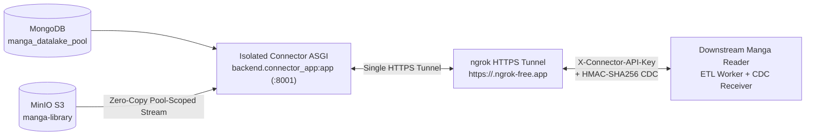

# External Source Connector & ngrok Gateway (ETL v2.0 + Media Proxy + CDC)

> **Role**: Exposes this repository's **Manga Data Lake & Storage Pool** as a third-party external manga source for downstream Manga Reader applications (`manga-reader-package` v2.0).
> **Base Path**: `/api/connector/v1`
> **Contract**: [`docs/contracts/reader-contract-v2.md`](./reader-contract-v2.md) (`urn:manga-datalake:contract:manga-reader-package:2.0`)

---

## 1. Architecture & Security Isolation



### Defense-in-Depth Boundaries
1. **Isolated Connector Server (`backend.connector_app:app`, port `8001`)**:
   - Mounts **ONLY** `/api/connector/v1/*` and `/health`.
   - Zero personal review, library editor, deletion, or internal admin routes exist in this ASGI application.
2. **Tunnel Path Guard (`ConnectorExposureMiddleware`)**:
   - Mounted on the main backend (`backend.main:app`, port `8000`) as a secondary safety net.
   - Any request arriving with a non-loopback `Host` or `X-Forwarded-Host` (such as `*.ngrok-free.app` or `*.trycloudflare.com`) is strictly restricted to `/api/connector/v1/*` and `/health`; all other routes return `403 CONNECTOR_ROUTE_RESTRICTED`.
3. **Fail-Closed API Key Authentication**:
   - Every `/api/connector/v1/*` endpoint requires `X-Connector-API-Key: <key>` (or `Authorization: Bearer <key>`), verified via constant-time `hmac.compare_digest`.
   - If `CONNECTOR_API_KEY` is unset, external requests fail closed with `503`.
4. **Published + ETL-Ready Pool Scoping**:
   - Only mangas with `pool_state == "published"` and `is_etl_ready == true` appear in `/catalog`, `/packages/{id}`, and `/media/{bucket}/{key}`.
   - Media proxy enforces a strict bucket allowlist (`manga-library`), blocks path traversal (`..`, `\`, control chars), and verifies that `(bucket, object_key)` is referenced by a published ETL-ready manga before streaming from MinIO.

---

## 2. Quick Start with ngrok (Windows PowerShell)

1. Verify ngrok authentication once:
   ```powershell
   ngrok config add-authtoken <YOUR_NGROK_AUTHTOKEN>
   ngrok config check
   ```
2. Launch the isolated Connector (`:8001`) + ngrok HTTPS tunnel + live self-test:
   ```powershell
   .\scripts\start_connector_ngrok.ps1 -InitSecrets
   ```
   - `-InitSecrets` automatically generates cryptographically strong `CONNECTOR_API_KEY` and `CONNECTOR_WEBHOOK_SECRET` inside untracked `backend/.env` if not already set.
   - To use a reserved static ngrok domain:
     ```powershell
     .\scripts\start_connector_ngrok.ps1 -Domain your-reserved-name.ngrok-free.app
     ```
   - To run manually without the launcher:
     ```powershell
     # Terminal 1
     uv run --project backend uvicorn backend.connector_app:app --host 127.0.0.1 --port 8001
     # Terminal 2
     ngrok http http://127.0.0.1:8001
     ```
3. Inspect live status, auto-detected ngrok URL, CDC subscriptions, and delivery logs in the local UI at `/datalake-pool` -> **ETL Connector / ngrok**.

---

## 3. Downstream Reader Configuration (`.env`)

Configure the downstream Reader application with the live ngrok URL and shared secrets from `backend/.env`:

```ini
UPSTREAM_SOURCE_BASE_URL=https://<your-tunnel>.ngrok-free.app
UPSTREAM_SOURCE_API_KEY=<CONNECTOR_API_KEY>
UPSTREAM_WEBHOOK_SECRET=<CONNECTOR_WEBHOOK_SECRET>
```

> **ngrok Free Header Note**: All HTTP clients talking through an ngrok Free tunnel should include header `ngrok-skip-browser-warning: true` (alongside `X-Connector-API-Key: <key>`).

---

## 4. Connector API Reference (`/api/connector/v1`)

| Method | Path | Purpose | Key Headers / Query |
|---|---|---|---|
| `GET` | `/api/connector/v1/info` | Handshake, capabilities, contract version `2.0`, ready pool counts | `X-Connector-API-Key` |
| `GET` | `/api/connector/v1/contract/schema` | Pinned JSON Schema Draft 2020-12 (`urn:manga-datalake:contract:manga-reader-package:2.0`) | `X-Connector-API-Key` |
| `GET` | `/api/connector/v1/catalog` | Paginated list of published, ETL-ready manga packages | `search`, `language`, `status`, `content_rating`, `updated_since`, `page`, `page_size` |
| `GET` | `/api/connector/v1/packages/{pool_manga_id}` | Export strict `manga-reader-package:2.0` JSON (`?include_chapters=false` omits `chapters` per metadata-only update) | Returns `X-Payload-SHA256`, `ETag`, `X-Pool-Revision`; supports `If-None-Match` (`304`) |
| `GET` | `/api/connector/v1/packages/{pool_manga_id}/chapters/{pool_chapter_id}` | Fetch single strict `ReaderChapter` v2.0 JSON | Returns `X-Payload-SHA256`, `X-Pages-Revision` |
| `GET` / `HEAD` | `/api/connector/v1/media/{bucket}/{object_key}` | Zero-Copy pool-scoped media stream for covers & pages over the single ngrok tunnel | Returns `Content-Type`, `Content-Length`, `ETag`, `X-Content-SHA256`, immutable `Cache-Control` |
| `POST` | `/api/connector/v1/cdc/subscriptions` | Idempotently register per-manga CDC webhook subscription; returns `provider_subscription_key` | Body: `{pool_manga_id, callback_url, consumer_id, webhook_secret?, events?}` |
| `GET` | `/api/connector/v1/cdc/subscriptions` | List CDC subscriptions | `pool_manga_id`, `status`, `consumer_id` |
| `GET` | `/api/connector/v1/cdc/subscriptions/{subscription_key}` | Inspect one CDC subscription | — |
| `DELETE` | `/api/connector/v1/cdc/subscriptions/{subscription_key}` | Cancel CDC subscription (stops future pushes) | — |
| `POST` | `/api/connector/v1/cdc/subscriptions/{subscription_key}/test` | Send signed `SUBSCRIPTION_PING` test event | Returns delivery record |
| `GET` | `/api/connector/v1/cdc/events` | Pull/polling CDC event feed (fallback when Reader has no public callback URL) | `pool_manga_id`, `event_type`, `since`, `after_event_id`, `limit` |
| `GET` | `/api/connector/v1/cdc/deliveries` | Inspect outbound CDC webhook delivery logs | `subscription_key`, `pool_manga_id`, `status` |
| `POST` | `/api/connector/v1/cdc/deliveries/{delivery_id}/retry` | Retry a failed CDC webhook delivery | — |

---

## 5. CDC Webhook Envelope & HMAC-SHA256 Verification

Every CDC event persisted in `pool_cdc_events` and pushed to active subscribers follows this exact envelope:

```json
{
  "eventId": "evt_7d3c2e...",
  "eventType": "CHAPTER_CREATED",
  "occurredAt": "2026-11-20T14:00:00Z",
  "contractName": "manga-reader-package",
  "contractVersion": "2.0",
  "poolMangaId": "pm_e7e6faa814ab",
  "poolChapterId": "pch_4ee099aa23b4",
  "poolRevision": 2,
  "payloadSha256": "<64-hex-sha256-of-canonical-payload>",
  "payload": {}
}
```

### Event Types
- `MANGA_METADATA_UPDATED`: `payload` is a metadata-only `manga-reader-package:2.0` (root `chapters` omitted).
- `CHAPTER_CREATED` / `CHAPTER_UPDATED`: `payload` contains `chapter` (strict `ReaderChapter` v2.0), `manga_lineage`, and `manga_stats`.
- `CHAPTER_DELETED`: explicit chapter removal (`pool_manga_id`, `pool_chapter_id`, `reason`, `manga_lineage`, `manga_stats`).
- `MANGA_REMOVED`: manga removed from Data Lake Pool (downstream Reader keeps local data untouched unless Admin deletes it).
- `SUBSCRIPTION_PING`: signed connectivity probe.

### Webhook Signature Verification (Python Example)

Outbound webhook requests include:
- `X-Manga-Source-Timestamp`: Unix epoch seconds
- `X-Manga-Source-Signature`: `t=<ts>,v1=<HMAC-SHA256(secret, f"{ts}.".encode() + raw_body)>`
- `X-Webhook-Signature-256`: `sha256=<HMAC-SHA256(secret, raw_body)>`
- `X-Manga-Source-Event-Id`: matches `eventId`

```python
import hashlib
import hmac

def verify_source_webhook(secret: str, raw_body: bytes, sig_header: str, ts_header: str) -> bool:
    parts = dict(item.split("=", 1) for item in sig_header.split(",") if "=" in item)
    ts = parts.get("t") or ts_header
    expected = hmac.new(secret.encode("utf-8"), f"{ts}.".encode("ascii") + raw_body, hashlib.sha256).hexdigest()
    return hmac.compare_digest(parts.get("v1", ""), expected)
```

---

## 6. Automated End-to-End Verification

Test any live connector endpoint (local or ngrok HTTPS) using the bundled ETL verifier:

```powershell
uv run --project backend python scripts/verify_connector_etl.py `
  --base-url https://<your-tunnel>.ngrok-free.app `
  --api-key <YOUR_CONNECTOR_API_KEY> `
  --test-cdc
```
